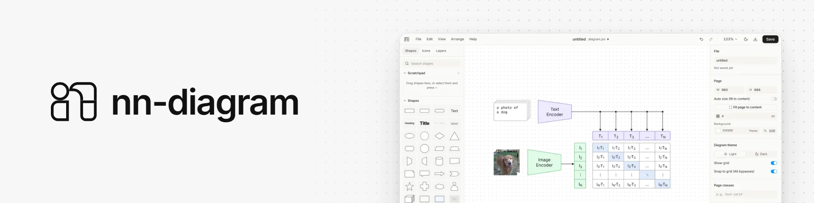

<picture>
  <source media="(prefers-color-scheme: dark)" srcset=".github/banner-dark.webp">
  
</picture>

A JSX-based diagram format with a visual editor, CLI, and interactive React viewer.

Each diagram is a plain text file (`*.diagram.jsx`) written with JSX and Tailwind classes. Every element has explicit coordinates, so the layout in the file matches what is rendered. You can edit the file directly or work in the visual editor, and switch between the two at any time.

- **Hover notes**: attach short Markdown and LaTeX explanations to any shape.
- **Walk-throughs**: step readers through a diagram one stage at a time.
- **Exports**: SVG and PDF with selectable text, or PNG, JPEG, and WebP in light or dark mode.

**[Try the editor](https://yanexr.github.io/nn-diagram/editor/)** · [Docs](https://yanexr.github.io/nn-diagram/) · [Format reference](https://yanexr.github.io/nn-diagram/reference.md)

Suitable for neural networks, system architectures, flowcharts or other figures. [nn-architectures](https://yanexr.github.io/nn-architectures/) is built with it.

## Example

```jsx
<Diagram width={400} height={120} grid={4}>
  <Box id="input" x={24} y={44} w={96} h={32} tip="Raw text from the user.">Input</Box>
  <Box id="model" x={160} y={40} w={96} h={40} variant="orange">Model</Box>
  <Box id="output" x={296} y={44} w={80} h={32}>Output</Box>
  <Arrow from="input" to="model" />
  <Arrow from="model" to="output" />
</Diagram>
```

## Use it with an AI agent

Install the agent skill so your coding agent knows the format and how to validate its output:

```sh
npx skills add yanexr/nn-diagram
```

You can then ask your agent to create or modify a diagram. In Claude Code, it can also be installed as a plugin with `/plugin marketplace add yanexr/nn-diagram`.

To adjust a diagram by hand, open the same file in the [editor](https://yanexr.github.io/nn-diagram/editor/). In Chrome and Edge, the editor saves changes straight back to disk and reloads whenever the file is updated externally.

## Command line

```sh
npx nn-diagram check diagrams/            # validate diagram files
npx nn-diagram render flow.diagram.jsx    # export PNG next to the file (also svg, pdf, jpeg, webp)
npx nn-diagram fmt diagrams/              # format files
```

Rendering requires Chrome, Edge, or Chromium.

## Use it in a website

| Package | Description |
|---|---|
| [`@nn-diagram/viewer`](packages/viewer) | React component for viewing diagrams with zoom, hover notes, steps, and export |
| [`@nn-diagram/editor`](packages/editor) | React component for the visual editor |
| [`@nn-diagram/format`](packages/format) | Parser, validator, and formatter for diagram files (no React dependency) |
| [`nn-diagram`](packages/cli) | Command-line tool and agent skill |

```sh
npm install @nn-diagram/viewer katex
```

```tsx
import { DiagramViewer } from "@nn-diagram/viewer";
import "@nn-diagram/viewer/styles.css";
import "katex/dist/katex.min.css";

<DiagramViewer source={text} />;
```

The viewer and editor ship with neutral light and dark themes. To match your site, override CSS variables such as `--primary`, `--radius`, and `--font-sans` (these follow [shadcn/ui](https://ui.shadcn.com/docs/theming) naming, so existing shadcn themes apply directly).

## License

[Apache-2.0](LICENSE). Arrow routing and segment handles are ported from [draw.io](https://github.com/jgraph/drawio) (Apache-2.0, JGraph Ltd); see [NOTICE](NOTICE).
